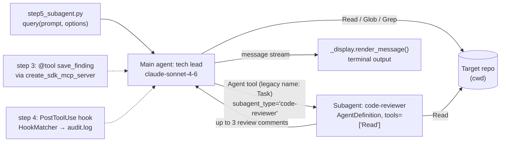

# Repo Inspector: a Claude Agent SDK starter

Learn the [Claude Agent SDK for Python](https://github.com/anthropics/claude-agent-sdk-python) in five small steps.
Each step is a standalone script that points an agent at a local code folder and adds **one** core SDK concept on top of the previous step.
A shared renderer (`_display.py`) prints every tool call and tool result, so you can watch the agent loop as it runs.

## What you'll learn

| Step | SDK concept | What it adds | File |
|------|-------------|--------------|------|
| 1 | `query()`, `ClaudeAgentOptions`, `allowed_tools` / `disallowed_tools`, `setting_sources=[]` | One-shot "tour of this repo" using only the built-in `Read`, `Glob`, `Grep` tools (model: `claude-haiku-4-5`) | [`step1_summarize.py`](step1_summarize.py) |
| 2 | `ClaudeSDKClient` | Multi-turn `you>` REPL: one session across many `client.query()` calls, so follow-up questions keep context | [`step2_chat.py`](step2_chat.py) |
| 3 | `@tool` + `create_sdk_mcp_server` + `mcp_servers` | A custom in-process Python tool, `save_finding(title, body)`, exposed as `mcp__findings__save_finding`; findings are appended to `findings.jsonl` | [`step3_findings.py`](step3_findings.py) |
| 4 | `HookMatcher` + `PostToolUse` hook | Every `Read` / `Glob` / `Grep` call is logged as one JSON line to `audit.log`, which is printed at the end of the run | [`step4_hooks.py`](step4_hooks.py) |
| 5 | `AgentDefinition` (subagents) + `agents=` | The main agent picks one file and delegates it to a `code-reviewer` subagent (its own prompt, `Read`-only tools, own context window), then summarizes the review | [`step5_subagent.py`](step5_subagent.py) |

Steps 2 to 5 use `claude-sonnet-4-6`. Shared helper: [`_display.py`](_display.py) renders the SDK message stream.

### Step 5 architecture

Step 5 shows subagents. Custom tools (step 3) and hooks (step 4) are separate scripts. The dashed boxes show where they plug into the same `ClaudeAgentOptions` if you combine the steps yourself.



## Setup

Requires Python 3.10+ (the SDK's minimum) and an Anthropic API key. The `claude-agent-sdk` wheel bundles the Claude Code CLI.

```bash
python3 -m venv .venv
source .venv/bin/activate
pip install -r requirements.txt   # claude-agent-sdk, python-dotenv
cp .env.example .env
# put your ANTHROPIC_API_KEY in .env (.env is gitignored)
```

## Run

Each step is standalone. Pass the path to any repo you want to inspect (default: current directory):

```bash
python step1_summarize.py ~/some/repo
python step2_chat.py      ~/some/repo
python step3_findings.py  ~/some/repo   # then: cat findings.jsonl
python step4_hooks.py     ~/some/repo   # then: cat audit.log
python step5_subagent.py  ~/some/repo
```

> **Note:** every run calls the Claude API and costs a small amount. The scripts have no `--help` flag. Any first argument is treated as the repo path and starts a run.

## What you'll see

The scripts print the SDK message stream through `_display.render_message()`. Each line gets one of these labels, taken from the code:

| Label | SDK message / block | Shows |
|-------|---------------------|-------|
| `[session]` | `SystemMessage` (subtype `init`) | model name and the tool list the session was given |
| `[assistant]` | `AssistantMessage` → `TextBlock` | the model's text |
| `[tool-call]` | `AssistantMessage` → `ToolUseBlock` | tool name plus JSON input, e.g. `Read({"file_path": ...})` |
| `[thinking]` | `AssistantMessage` → `ThinkingBlock` | first 200 chars of thinking, if any |
| `[tool-result]` / `[tool-error]` | `UserMessage` → `ToolResultBlock` | the tool output, truncated to 400 chars |
| `[done]` | `ResultMessage` | `turns=…  cost=$…  duration=…s` |

Files written next to the scripts (both gitignored): `findings.jsonl` (step 3, one `{"timestamp","title","body"}` record per finding) and `audit.log` (step 4, one `{"timestamp","tool","input"}` record per tool call, reset each run).

## Compatibility

All scripts were checked with `python -m py_compile` and an import test against **claude-agent-sdk 0.2.174** (bundled Claude Code CLI 2.1.310) on Python 3.12. That check did not call the API. The SDK objects (`@tool`, `create_sdk_mcp_server`, `AgentDefinition`, `ResultMessage`) were also built offline to confirm the current signatures.

## Built-in tools & why we disallow most of them

Claude Code ships a wide set of built-in tools. The Agent SDK inherits the same tool surface — you opt tools *in* with `allowed_tools` and opt them *out* with `disallowed_tools`. The authoritative reference is the [Tools reference](https://code.claude.com/docs/en/tools-reference) page in Anthropic's docs; this section is a working subset annotated with what each step in this repo does with each tool.

For these demos we want a tight surface: only `Read`, `Glob`, `Grep` (plus `Agent`, legacy name `Task`, in step 5 and our custom `save_finding` in step 3). Everything else is blocked.

**Why so aggressive?** The main reason isn't safety — it's **learnability**. These scripts exist so you can *watch* the agent loop: each tool call and tool result is printed to the terminal. The fewer tools the model has, the easier those traces are to follow. With the full default surface the model wanders into `Agent`/`Skill`/`Bash` for things `Read` would have handled, and the trace stops being a clean illustration of the SDK concept the step is trying to teach.

### File I/O

| Tool | What it does | Status here |
|------|--------------|-------------|
| `Read` | Read a file, with line numbers; handles text, images, PDFs, and Jupyter notebooks | ✅ **allowed** — core of repo exploration |
| `Write` | Create or fully overwrite a file | ❌ disallowed — read-only demos |
| `Edit` | Exact string replacement in an existing file (read-before-edit enforced) | ❌ disallowed — read-only demos |
| `NotebookEdit` | Insert / replace / delete cells in a `.ipynb` notebook | ❌ disallowed — read-only demos |

### Search & code intelligence

| Tool | What it does | Status here |
|------|--------------|-------------|
| `Glob` | Find files by name pattern (`**/*.py`); sorted by mtime | ✅ **allowed** — locate files |
| `Grep` | ripgrep-based content search with regex, glob, and language filters | ✅ **allowed** — find symbols/strings |
| `LSP` | Language-server-backed jump-to-definition, references, diagnostics | ❌ disallowed — requires a code-intelligence plugin; out of scope |

### Shell & process

| Tool | What it does | Status here |
|------|--------------|-------------|
| `Bash` | Run a shell command (per-command process, no env persistence) | ❌ disallowed — side effects on the host; we want pure observation |
| `PowerShell` | Native PowerShell command execution (opt-in outside Windows) | ❌ disallowed — same reason as Bash |
| `Monitor` | Run a script in the background and stream each output line back as an event | ❌ disallowed — no background work to watch |

### Web

| Tool | What it does | Status here |
|------|--------------|-------------|
| `WebFetch` | Fetch a URL and run a sub-prompt to extract content (lossy by design) | ❌ disallowed — keep runs offline + deterministic |
| `WebSearch` | Run a web search through Anthropic's search backend | ❌ disallowed — keep runs offline + deterministic |

### Subagents & delegation

| Tool | What it does | Status here |
|------|--------------|-------------|
| `Agent` | Spawn a subagent in its own context window and return its final answer | ✅ **allowed in step 5** to dispatch to our `code-reviewer` subagent; disallowed elsewhere |

### User input & planning

| Tool | What it does | Status here |
|------|--------------|-------------|
| `AskUserQuestion` | Ask the user a multiple-choice question with structured options | ❌ disallowed — scripts are non-interactive |
| `EnterPlanMode` | Switch into plan mode to design an approach before acting | ❌ disallowed — adds a planning round-trip we don't need |
| `ExitPlanMode` | Surface the plan for approval and leave plan mode | ❌ disallowed — same |

### Git worktrees

| Tool | What it does | Status here |
|------|--------------|-------------|
| `EnterWorktree` | Create or switch into an isolated git worktree | ❌ disallowed — not a git workflow demo |
| `ExitWorktree` | Leave a worktree and return to the original directory | ❌ disallowed — same |

### Task list (session todos)

| Tool | What it does | Status here |
|------|--------------|-------------|
| `TaskCreate` | Add a task to the session task list | ❌ disallowed — single-shot scripts don't need progress tracking |
| `TaskGet` | Read one task's details | ❌ disallowed |
| `TaskList` | List all tasks with status | ❌ disallowed |
| `TaskOutput` | (Deprecated) Read a background task's output file | ❌ disallowed |
| `TaskStop` | Kill a running background task | ❌ disallowed |
| `TaskUpdate` | Change a task's status, dependencies, or details | ❌ disallowed |
| `TodoWrite` | Legacy todo-list tool (off by default since v2.1.142) | not used |

### Scheduling

| Tool | What it does | Status here |
|------|--------------|-------------|
| `CronCreate` | Schedule a session-scoped recurring or one-shot prompt | ❌ disallowed — not a scheduling demo |
| `CronDelete` | Cancel a scheduled task | ❌ disallowed |
| `CronList` | List scheduled tasks | ❌ disallowed |
| `ScheduleWakeup` | Pick when the next `/loop` iteration runs (1 min–1 hr) | ❌ disallowed — not a `/loop`-paced flow |
| `RemoteTrigger` | Create / run / list cloud Routines on claude.ai | ❌ disallowed — local demos only |

### Notifications & user-facing UX

| Tool | What it does | Status here |
|------|--------------|-------------|
| `PushNotification` | Desktop / phone push notification (Anthropic-hosted) | ❌ disallowed |
| `ShareOnboardingGuide` | Upload `ONBOARDING.md` and return a teammate share link | ❌ disallowed |

### Skills

| Tool | What it does | Status here |
|------|--------------|-------------|
| `Skill` | Invoke a `.claude/skills/*/SKILL.md` skill inside the current conversation | ❌ disallowed — skills are a separate surface; not used here |

### MCP plumbing

| Tool | What it does | Status here |
|------|--------------|-------------|
| `ListMcpResourcesTool` | List resources exposed by connected MCP servers | not used |
| `ReadMcpResourceTool` | Read a specific MCP resource by URI | not used |
| `ToolSearch` | Load schemas for deferred MCP tools on demand | ❌ disallowed — we declare the allowlist upfront |
| `WaitForMcpServers` | Wait for still-connecting MCP servers before using them | not used |

### Experimental: agent teams

| Tool | What it does | Status here |
|------|--------------|-------------|
| `SendMessage` | Message a teammate or resume a subagent by ID | not enabled (requires `CLAUDE_CODE_EXPERIMENTAL_AGENT_TEAMS=1`) |
| `TeamCreate` | Create a multi-teammate agent team | not enabled |
| `TeamDelete` | Disband a team and clean up its processes | not enabled |

### Why keep an explicit disallow list at all?

`allowed_tools` is already a positive allowlist, so why also enumerate the negative side?

1. **Defense in depth.** If a future SDK release auto-allows a new tool category (a new MCP plumbing tool, say), the explicit `disallowed_tools` still blocks it for these demos.
2. **Readability.** A reader of the script can see what the author *considered and rejected*, not just what was allowed.
3. **Subagents inherit differently.** A subagent with `tools=["Read"]` already gets only `Read`, but if you forget the `tools` field, the subagent inherits the parent's whole surface. The disallow list is a backstop for that case.

## Next steps / further reading

- [Agent SDK overview](https://code.claude.com/docs/en/agent-sdk/overview)
- [Python SDK reference](https://code.claude.com/docs/en/agent-sdk/python): `query()`, `ClaudeSDKClient`, `ClaudeAgentOptions`, message types
- [Streaming vs single mode](https://code.claude.com/docs/en/agent-sdk/streaming-vs-single-mode) (steps 1 and 2)
- [Custom tools](https://code.claude.com/docs/en/agent-sdk/custom-tools) (step 3)
- [Hooks](https://code.claude.com/docs/en/agent-sdk/hooks) (step 4)
- [Subagents](https://code.claude.com/docs/en/agent-sdk/subagents) (step 5)
- [Tools reference](https://code.claude.com/docs/en/tools-reference): every built-in tool name
- [anthropics/claude-agent-sdk-python](https://github.com/anthropics/claude-agent-sdk-python) and [PyPI package](https://pypi.org/project/claude-agent-sdk/)

Ideas to extend it yourself: merge steps 3 to 5 into one agent (custom tool + audit hook + subagent), add a `PreToolUse` hook that blocks reads outside the repo, or set `max_budget_usd` / `max_turns` on `ClaudeAgentOptions` to cap the cost of each run.
